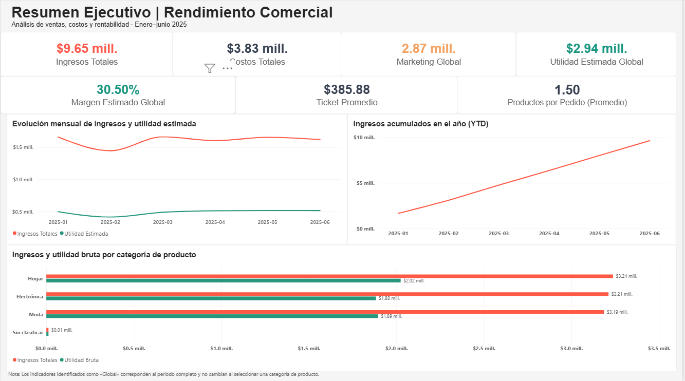
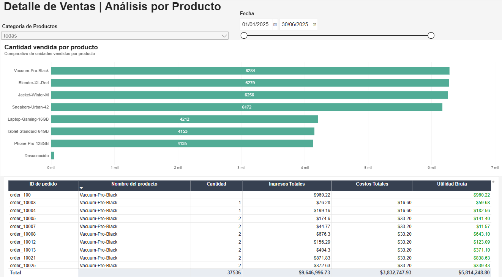
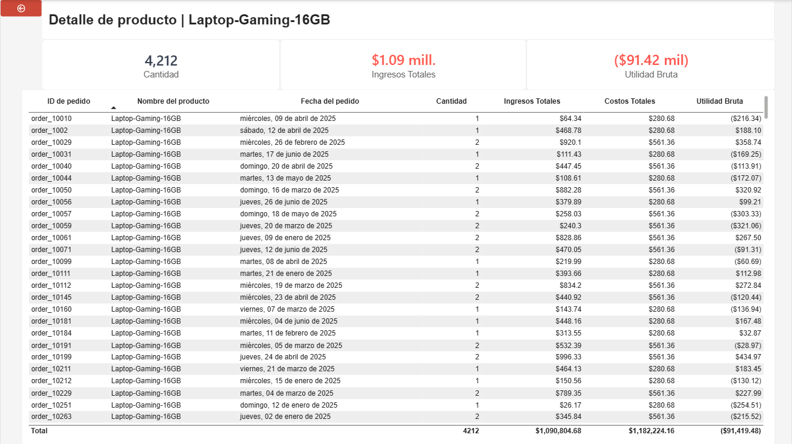

# retail-sales-profitability-analysis
End-to-end retail sales and profitability analysis using Python and Power BI, featuring data cleaning, KPI validation, interactive dashboards, and actionable business insights.
# RappiPlus | From Data to Business Decisions

**End-to-end business analytics project | Python · SQL · Power BI · A/B Testing**

## Project Overview

This project analyzes RappiPlus commercial performance and user behavior to support data-driven business decisions. It combines transaction records, product costs, marketing expenditure, platform events, registration cohorts, and a checkout A/B experiment.

The workflow covers data quality validation, financial KPIs, conversion funnel analysis, cohort retention, statistical testing, and interactive Power BI reporting. The analysis preserves data limitations rather than imputing unsupported values or overstating causal conclusions.

**Analysis period for commercial reporting:** January–June 2025.

## Business Questions

- How much revenue and calculated gross profit did the business generate, and how do these differ from estimated overall profit after marketing expenditure?
- Which categories and products contribute most to gross profit, and which require investigation?
- Where do aggregate user counts decrease across the purchase funnel?
- How many registered users are active at days 7, 14, and 21?
- Does the checkout UI treatment show a statistically significant difference in purchase conversion?

## Tools and Methods

| Tool | Application |
| --- | --- |
| Python (Pandas) | Data cleaning, validation, KPI calculations and analysis |
| SQL (PostgreSQL) | Event aggregation, funnel checks and cohort retention |
| Statsmodels | Two-sided Z-test for independent conversion proportions |
| Power BI | Interactive financial and product-performance reporting |
| Jupyter Notebook | Reproducible analytical narrative and documentation |

## Analytical Workflow

1. **Data quality:** Inspect data types, missing values, duplicates and anomalies. Recover values only where supported by available evidence; preserve four negative transactions and document unresolved missing values.
2. **Business profitability:** Calculate revenue, known product costs, gross profit, marketing expenditure, estimated profit and sales KPIs.
3. **Conversion funnel:** Compare distinct-user counts across `first_visit → select_item → add_to_cart → begin_checkout → add_payment_info → purchase`, including overlap and timestamp checks.
4. **Cohort retention:** Measure activity on days 7, 14 and 21 after registration for monthly registration cohorts.
5. **A/B testing:** Compare checkout purchase-conversion proportions with a two-sided Z-test at α = 0.05.
6. **Power BI reporting:** Explore financial performance, category and product results, and product-level drill-through details.

## Selected Results

### Commercial performance

| Metric | Result |
| --- | ---: |
| Revenue | 9,646,996.73 USD |
| Known product costs | 3,832,747.93 USD |
| Calculated gross profit | 5,814,248.80 USD |
| Gross margin | 60.27% |
| Marketing expenditure | 2,871,843.53 USD |
| Estimated overall profit after marketing | 2,942,405.27 USD |
| Estimated overall profit margin | 30.50% |

**Interpretation:** Estimated overall profit is *not* verified accounting net profit. Product costs are incomplete for some orders, and other operating expenses are not included.

### Product and category insights

- **Home (`Hogar`)** had the highest category gross margin at **62.52%**, followed by Fashion (`Moda`) at **59.49%** and Electronics (`Electrónica`) at **58.63%**.
- `Vacuum-Pro-Black` and `Sneakers-Urban-42` contributed approximately **51.4%** of calculated gross profit combined.
- `Laptop-Gaming-16GB` generated a **91,419.48 USD gross loss**, with a **-8.38% gross margin**, and showed negative gross profit in each of the six months analyzed.

### User behavior and experimentation

| Analysis | Finding |
| --- | --- |
| Funnel | 7,796 users recorded `first_visit`; 6,240 recorded `purchase` (aggregate ratio **80.04%**) |
| Largest adjacent-stage drop | `begin_checkout` to `add_payment_info`: **958 fewer distinct users** |
| Retention | Unweighted mean checkpoint activity: **42.01%** (day 7), **41.96%** (day 14), **41.92%** (day 21) |
| A/B test | Control **15.69%** vs. treatment **16.29%**; **p = 0.4162** |

**Interpretation:** Funnel ratios compare event-level distinct-user groups, not a fully validated sequential user journey. Retention refers to activity at individual checkpoints, not cumulative churn. The A/B test did **not** find a statistically significant conversion difference at α = 0.05.

## Power BI Report

The report contains three pages:

1. **Executive Overview | Commercial Performance** — Financial KPIs, monthly trends, YTD revenue and category comparisons.
2. **Sales Detail | Product Analysis** — Product sales volume, detailed records and interactive date/category filters.
3. **Product Detail** — Drill-through page with selected-product revenue, quantities, costs and gross profit.

The Power BI report includes three analytical pages: an executive overview, product-level sales analysis, and an interactive drill-through page. Screenshots are provided below to illustrate the report's design, key metrics, and analytical capabilities.

The executive dashboard provides a consolidated view
of RappiPlus's commercial performance from January
to June 2025. It highlights total revenue, known
product costs, marketing expenditure, estimated
profitability, monthly performance trends,
year-to-date revenue, and gross profit by
product category.

*Figure 1. Executive overview of sales performance,
estimated profitability, and gross profit by
product category.*

### Sales Detail | Product Analysis

This dashboard provides a detailed view of product-level
sales performance, with interactive filters for product
category and date range. It compares units sold across
products and includes a transaction-level table displaying
order IDs, product names, quantities, revenue, known
product costs, and calculated gross profit.

Conditional formatting helps highlight differences in gross
profitability, while the filters allow users to explore
specific product categories and reporting periods.

*Figure 2. Product sales volume, interactive filtering,
and transaction-level profitability analysis.*

### Product Detail | Drill-through Analysis

The drill-through page allows users to investigate
individual products directly from the sales analysis
dashboard. It displays product-specific units sold,
revenue, gross profit, and transaction-level records,
helping identify potential profitability issues.

The example below focuses on **Laptop-Gaming-16GB**,
which generated approximately 1.09 million USD in
revenue but recorded a gross loss of 91,419.48 USD,
representing a gross margin of -8.38%.

This finding highlights the importance of evaluating
product profitability alongside sales volume and
supports further investigation into pricing, discounts,
and product costs.

*Figure 3. Product-level drill-through analysis
highlighting negative gross profitability for
Laptop-Gaming-16GB.*

## Recommendations

- Investigate the pricing, discounts and unit costs of `Laptop-Gaming-16GB` to understand its persistent gross losses.
- Monitor high-contribution products for changes in demand and gross margin.
- Track gross margin regularly at the product and category levels.
- Improve completeness of quantity, unit-price and product-cost records.
- Investigate checkout-stage friction with more strictly sequential event tracking before attributing losses to a particular step.
- Avoid rolling out the tested checkout UI change solely on the observed uplift without stronger statistical evidence.

## Data Quality and Limitations

- **50 orders** have missing quantity, unit price and discount information; **80 orders** lack sufficient information for calculating product costs.
- Four negative transactions were retained because they may represent returns, cancellations or reversals; their exact nature could not be confirmed.
- Gross profit may be overstated when product costs are unknown. Missing cost is **not** equivalent to zero cost.
- Marketing expenditure is evaluated at the overall business level; it is **not attributed to products or categories**.
- The PostgreSQL source is an academic environment with restricted access. SQL analyses may require authorized credentials and cannot be assumed to run for all repository visitors.

## Data Sources

- `rappiplus_orders_raw.csv` — Orders and transaction details
- `rappiplus_catalog.csv` — Product catalog and costs
- `rappiplus_marketing_spend.csv` — Marketing expenditure
- PostgreSQL: `events`, `users`, `user_activity` — Behavioral and cohort analysis
- `experiment_checkout_ui.csv` — Checkout experiment

**Publication note:** Source data and cleaned exports should be included only after confirming redistribution permission. No database passwords, private URLs or other credentials should be committed.

## Repository and Reproducibility

The finalized repository will provide the translated Jupyter notebook, a Power BI report, selected screenshots and documentation. Local execution requires Python with `pandas`, `sqlalchemy`, `statsmodels` and a PostgreSQL driver compatible with the notebook's connection string. Power BI Desktop is needed to open the `.pbix` file.

Database-backed steps require access to the academic PostgreSQL server. If that access is unavailable, the notebook still documents the SQL logic and the previously validated results, but those queries cannot be rerun without an authorized data source.

## Project Context

Developed as the final Data Analytics project for the TripleTen program and approved by its reviewers. This repository presents the project in English for professional portfolio purposes.
